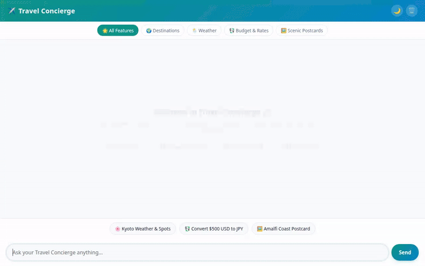

# ✈️ Travel Concierge Agent

A conversational AI travel concierge built with the **Google Agent Development Kit (ADK)**. It helps travelers discover destination recommendations, query live weather conditions, generate scenic destination postcards and video clips, convert trip budgets, and explore nearby attractions.



---

## 🌟 Overview

The **Travel Concierge Agent** combines Google's multimodal Gemini models with real-world travel APIs and persistent memory. It operates as a full-stack agentic web app with an interactive, responsive chat interface and rich display UI cards.

---

## 🚀 Wired & Implemented Capabilities

The following services and tools are fully implemented and wired into the codebase (`app/` and `frontend/`):

### 🧠 Core Agent & Framework
- **Google ADK (`google.adk`)**: Powered by `gemini-2.5-flash` model with Python code execution support.
- **Vertex AI Memory Bank**: Integrates `PreloadMemoryTool` and callback hooks to maintain long-term user travel preferences across sessions.
- **A2UI Display Cards**: Native A2UI renderer (`a2ui_callback`) that outputs formatted interactive destination cards and weather widgets directly into the chat UI.

### 🗄️ Database & Cloud Services
- **Google Cloud Firestore**: Real-time database storing the destination catalog (`get_destination`, `search_destinations`, `add_destination`).
- **Google Cloud Storage (GCS)**: Public asset storage bucket (`travel-concierge-assets-qwiklabs-gcp-03-3746c509ea15`) for generated destination images and video previews.

### 🎨 Generative Media Tools
- **Gemini Image Generation (`gemini-3.1-flash-lite-image`)**: Generates high-quality scenic destination postcards in the `global` region (`generate_travel_image`), saving ADK artifacts and publishing GCS URLs.
- **Google Omni Video Generation (`gemini-omni-flash-preview`)**: Generates cinematic video previews in the `global` region via the Interactions API (`generate_travel_video`), saving ADK artifacts and publishing GCS video URLs.
- **Pillow Postcard Generator**: Programmatic graphic postcard generator (`generate_destination_image`).

### 🌐 Real-World Travel APIs
- **Live Weather Lookup**: Real-time global weather forecasts via Open-Meteo REST API (`get_live_weather`).
- **Currency Conversion**: Real-time exchange rate calculation via Frankfurter REST API (`convert_currency`).
- **Google Maps Geocoding API**: Address-to-coordinate geocoding (`geocode_address`).
- **Google Places API (v1)**: Nearby venue and attraction discovery by coordinate radius (`find_nearby_places`).

### 💻 Web Interface & Proxy
- **FastAPI Proxy**: A2A protocol proxy bridge (`frontend/main.py`) connecting the browser UI to the Agent Engine runtime.
- **Modern Single-Page UI**: HTML5/CSS3 frontend featuring Google Font *Outfit*, dark mode toggle, animated typing indicator, welcome hero card, lightbox media preview modal, and category shortcut pills.

---

## 📌 Planned / Stretch Features

- **Interactive Embedded Google Maps Widget**: Rendering an interactive JavaScript map component in the chat UI for route visualization (planned, not yet implemented).

---

## 🛠️ Local Setup & Run Instructions

### Prerequisites
- Python 3.10+
- Google Cloud SDK (`gcloud`) with active Google Cloud credentials (`gcloud auth application-default login`)

### 1. Installation

Clone the repository and set up a virtual environment:

```bash
git clone <your-repo-url>
cd travel-concierge
python3 -m venv .venv
source .venv/bin/activate
pip install -r pyproject.toml
```

### 2. Environment Configuration

Copy the example environment file and set your project details:

```bash
cp .env.example .env
```

Ensure your `.env` contains:
```env
GOOGLE_CLOUD_PROJECT=qwiklabs-gcp-03-3746c509ea15
LOCATION=us-central1
```

### 3. Run the Agent Locally (ADK Web)

To test the agent using the ADK developer UI:

```bash
adk web
```

### 4. Run the Web Frontend & Proxy Locally

To launch the custom FastAPI proxy and chat interface:

```bash
cd frontend
pip install -r requirements.txt
python main.py
```

Open your browser to the local port output by Uvicorn to interact with the Travel Concierge.
